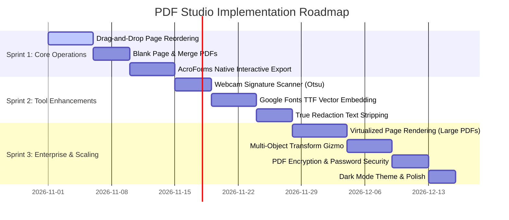

# PDF Studio: TODO Roadmap, Incomplete Tasks & Feature Improvements

> **Document Purpose:** Comprehensive roadmap outlining current project status, incomplete/in-progress features, technical debt, and high-impact architectural improvements inspired by industry leaders (Sejda, Adobe Acrobat Web, Smallpdf).

---

## 📊 1. Current Status Matrix

| Component / Feature | Current State | Completeness | Priority for Next Phase |
| :--- | :--- | :---: | :---: |
| **PDF Rendering Engine** | Renders via PDF.js on high-DPI `<canvas>` | **90%** | Add virtualized lazy-loading for 50+ page docs |
| **Inline Text Editing** | Click-to-edit with automatic whiteout underlay | **85%** | Add multi-font embedding & ligature handling |
| **Freehand & Annotations** | Smooth pen & translucent highlighter | **90%** | Add path smoothing (Catmull-Rom) & eraser tool |
| **Shapes & Lines** | Rectangle, Ellipse, Line, Arrow | **85%** | Add polygon, star, and border dash styling |
| **Signatures** | Draw, Type (calligraphy fonts), and Upload | **90%** | Add webcam capture & signature background removal |
| **Images & Stamps** | Upload, place, resize, and delete | **85%** | Add opacity slider & standard stamps (Approved, Draft) |
| **Form Builder** | Interactive inputs, checkboxes, and radio | **75%** | Export true fillable AcroForms into the PDF |
| **Page Management** | 90° rotation, deletion, thumbnails | **70%** | Add drag-and-drop page reordering & blank page insertion |
| **Redaction / Whiteout** | Visual vector whiteout boxes | **70%** | Add true cryptographic text removal (True Redaction) |
| **Find & Replace** | Cross-document search & batch replace | **80%** | Add match navigation (Next/Prev) & regex search |
| **Vector PDF Export** | `pdf-lib` vector recompiler | **90%** | Add PDF compression & metadata editing |
| **Authentication System** | Sejda-style Turnstile, SSO, and 2FA UI | **85%** | Connect to live backend database/OAuth endpoints |

---

## 📋 2. Incomplete Tasks & Immediate TODOs

### Phase 1: High-Priority Document Operations
- [ ] **Drag-and-Drop Page Reordering:**
  - *Current state:* Sidebar displays thumbnail list with rotation and delete actions.
  - *Task:* Implement HTML5 Drag-and-Drop or Sortable list in `src/components/sidebar.js` so users can reorder pages visually, updating `pdfDoc` page indices during export.
- [ ] **Insert Blank Page & Merge External PDF:**
  - *Current state:* `+ Add Blank Page` button triggers a notification stub.
  - *Task:* Implement `pdfDoc.addPage()` or insert page at specific index, and add a "Merge PDF" dialog allowing users to upload a second PDF and append/interleave pages.
- [ ] **Full AcroForms Native Export:**
  - *Current state:* Form fields (text inputs, checkboxes) are drawn as visual vector graphics in the exported PDF.
  - *Task:* Use `pdf-lib`'s `pdfDoc.getForm().createTextField()` and `createCheckBox()` so the exported PDF contains real, clickable, fillable form fields when opened in Adobe Acrobat or mobile viewers.

### Phase 2: Editing & UX Polish
- [ ] **True Text Redaction (Security):**
  - *Current state:* Whiteout places an opaque white rectangle over the text.
  - *Task:* For sensitive compliance use cases, strip the underlying character text streams from the exported PDF content stream so text cannot be extracted by selecting/copying underneath the whiteout box.
- [ ] **Webcam Signature Capture:**
  - *Current state:* Signature modal supports **Draw**, **Type**, and **Upload**.
  - *Task:* Add a 4th tab: **Camera**, utilizing `navigator.mediaDevices.getUserMedia()`, capturing the video feed, and applying an edge/luminance threshold filter (Otsu's method) to remove paper background and retain only ink.
- [ ] **Font Catalog Expansion:**
  - *Current state:* Text tool exports Helvetica, Times Roman, and Courier.
  - *Task:* Integrate Google Web Fonts (Roboto, Open Sans, Lato, Montserrat, Poppins) and embed their `.ttf`/`.woff` font bytes into `pdf-lib` using `pdfDoc.embedFont(fontBytes)`.
- [ ] **Eraser Tool:**
  - *Task:* A dedicated eraser tool that clears freehand pen and highlighter strokes under the cursor without removing the entire annotation object.

---

## 💡 3. Recommended Architectural & Feature Improvements

### A. Performance: Virtualized Page Windowing (Large Documents)
* **Problem:** Rendering 100 pages of high-resolution canvas simultaneously consumes hundreds of megabytes of GPU/RAM.
* **Solution:** Implement an `IntersectionObserver` in `CanvasManager`. Only render the active viewport pages plus 1 buffer page above and below. Off-screen pages retain lightweight placeholder divs, releasing their `<canvas>` contexts until scrolled into view.

### B. Selection Handles & Multi-Object Transform Gizmo
* **Feature:** Add 8-point bounding box handles (corners + edges) with a rotation handle at the top for placed text, shapes, and images.
* **Benefit:** Allows users to freely scale diagonally, rotate arbitrarily, and multi-select objects using `Shift + Click` or area marquee drag.

### C. Standard PDF Stamps & Watermarking
* **Feature:** Add a quick-stamp dropdown:
  * **Status Stamps:** `APPROVED`, `DRAFT`, `CONFIDENTIAL`, `VOID`, `FINAL`.
  * **Dynamic Date Stamps:** Automatically stamps the current date and user initials.
  * **Tiled Watermarks:** Semi-transparent text watermarks across the diagonal of all pages (e.g. *"CONFIDENTIAL - FOR REVIEW ONLY"*).

### D. PDF Security & Document Metadata
* **Feature:**
  * **Password Protection:** Encrypt PDF with user/owner passwords and AES-256 encryption via `pdf-lib`.
  * **Permissions:** Restrict printing, content copying, and form modification.
  * **Document Properties:** View and edit PDF Title, Author, Subject, Keywords, and Creator metadata.

### E. PDF Optimization & Compression
* **Feature:** Many PDFs grow large when adding images. Provide an "Export & Compress" option:
  * Downsample embedded images to 150 DPI (screen quality) or 300 DPI (print quality).
  * Run stream object compression (FlateDecode) to minimize file size before download.

### F. Dark Mode & Studio Theme Toggle
* **Feature:** Add a theme toggle in the top navbar (`Light`, `Dark`, `System Default`).
* **Design:** Sleek charcoal/slate dark theme (`#0f172a` workspace with high-contrast document backing) reducing eye strain during long document editing sessions.

---

## 🗓️ 4. Recommended Sprint Roadmap

---

## 🏁 5. Quick-Action Checklist to Start Today

1. **Test Reordering:** Open `src/components/sidebar.js` and add drag handlers (`dragstart`, `dragover`, `drop`) on `.thumb-card`.
2. **Test Fillable Forms:** Update `src/core/pdf-engine.js` export loop to call `pdfDoc.getForm().createTextField()` when `ann.type === 'form'`.
3. **Test Custom Fonts:** Download a Google Font `.ttf` into `src/assets/fonts/` and pass it to `pdfDoc.embedFont()`.

---

## 🌐 6. The Complete 30+ Sejda Tools Expansion Plan

Below is the roadmap for extending our PDF Studio suite to match every single tool on Sejda's platform. Complete technical recipes and reverse-engineering findings are documented in [`SEJDA_FULL_SUITE_REVERSE_ENGINEERING.md`](file:///home/codxbrexx/Pdf-Editor/SEJDA_FULL_SUITE_REVERSE_ENGINEERING.md).

### Category 1: Merge, Split & Page Organization
- [ ] **Merge PDF (`/merge-pdf`):** Combine multiple PDF uploads into one document using `PDFDocument.create()` and `copyPages()`.
- [ ] **Alternate & Mix (`/alternate-mix-pdf`):** Interleave odd pages from Doc A and even pages from Doc B (duplex scanner flow).
- [ ] **Organize & Reorder (`/organize-pdf`):** Visual full-grid page drag-and-drop sequencing.
- [ ] **Split by Pages (`/split-pdf`):** Subdivide document by custom ranges (e.g. `1-3, 4-7, 8-12`).
- [ ] **Split in Half (`/split-pdf-down-the-middle`):** Bisect A3 or two-page book scans down the center into separate A4 pages.
- [ ] **Delete & Extract Pages (`/delete-pdf-pages` & `/extract-pdf-pages`):** Extract selected pages to new file.

### Category 2: Security & Watermarking
- [ ] **Protect / Encrypt (`/encrypt-pdf`):** User & owner passwords with AES-256 and print/copy restriction flags.
- [ ] **Unlock (`/unlock-pdf`):** Decrypt and strip password restrictions.
- [ ] **Watermark (`/watermark-pdf`):** Diagonal text or logo watermark with configurable opacity (0.1 - 1.0) and rotation angle.
- [ ] **Flatten (`/flatten-pdf`):** Bake all form fields and annotations permanently into the page stream.

### Category 3: Page Geometry & Dimensions
- [ ] **Crop PDF (`/crop-pdf`):** Interactive marquee crop setting `setCropBox()`.
- [ ] **Resize Margins (`/resize-pdf`):** Adjust page bounds (A4, Letter) and add margin padding for binding.
- [ ] **Bates Numbering (`/bates-numbering-pdf`):** Legal numbering sequences with custom prefix and zero-padding.
- [ ] **Header & Footer / Page Numbers (`/header-footer-pdf`):** Apply `Page {n} of {total}` across all pages with 6 alignment positions.
- [ ] **N-Up Printing (`/n-up-pdf`):** Place 2 or 4 pages per sheet onto an enlarged page.

### Category 4: Conversions & OCR
- [ ] **PDF to JPG / PNG (`/pdf-to-jpg`):** Render pages at 72, 150, or 300 DPI and download individual images or a ZIP.
- [ ] **JPG / Images to PDF (`/jpg-to-pdf`):** Pack multiple image files into a single multi-page PDF document.
- [ ] **PDF to Text (`/extract-text-from-pdf`):** Extract all searchable document text using `page.getTextContent()`.
- [ ] **Edit Metadata (`/edit-pdf-metadata`):** Update Title, Author, Subject, Keywords, and Creator tags.
- [ ] **OCR PDF (`/ocr-pdf`):** Run Tesseract.js (WebAssembly) on image pages to inject an invisible searchable text layer.

